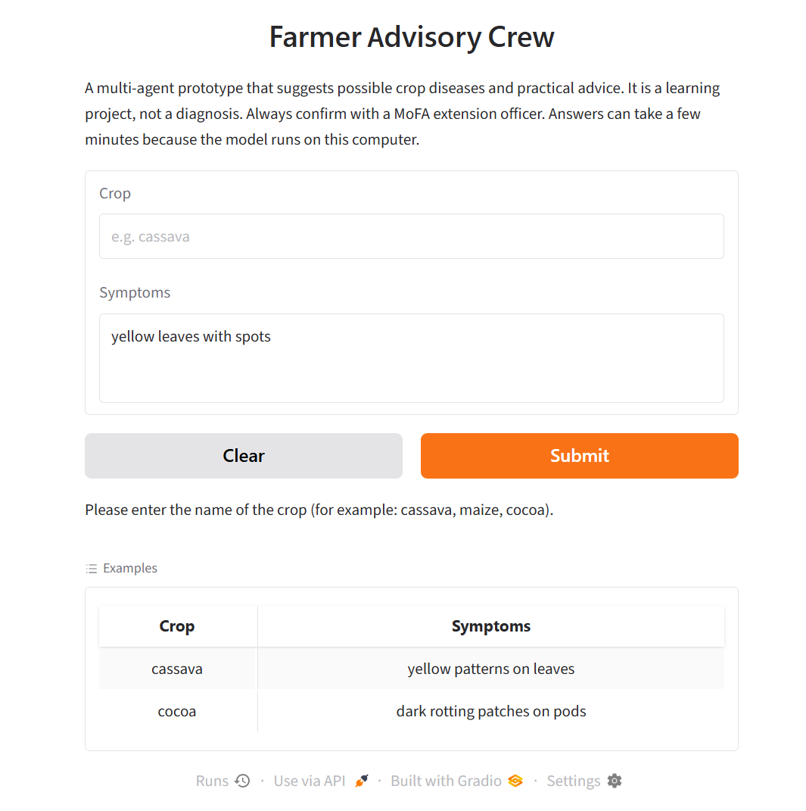
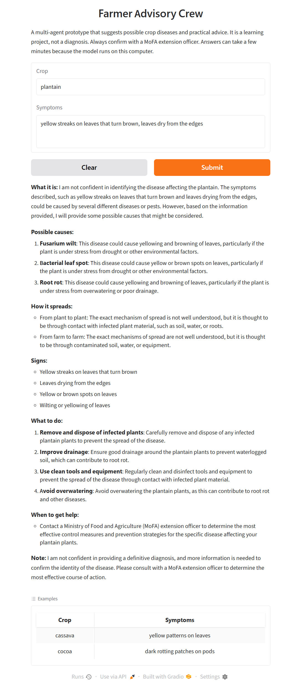

# Farmer Advisory Crew 

A multi-agent AI prototype that suggests possible crop diseases from a
crop name and a symptom description, then gives simple, practical advice
for smallholder farmers in Ghana.

> **This is a learning project, not a diagnostic tool.** Always confirm
> with a Ministry of Food and Agriculture (MoFA) extension officer.

## Why I built this

I'm a third-year Computer Science student at KNUST
and I'm just starting in AI. I wanted a first project that tackles a real
Ghanaian problem. Many farmers lose crops to diseases they can't identify
early, and extension officers can't be everywhere. This project is my
first step toward understanding how AI could help.

## How it works

Four AI agents work in sequence using [CrewAI](https://www.crewai.com/),
running a local model (llama3.2) through Ollama:

1. **Crop Disease Identifier**: suggests likely diseases from the crop and symptoms
2. **Cause and Spread Analyst**: explains what causes each disease and how it spreads
3. **Treatment and Prevention Specialist**: suggests practical control and prevention steps
4. **Farmer Advice Reviewer**: rewrites everything in plain language and a fixed format

The interface is built with Gradio and includes basic input validation.

## How to run it

1. Install [Ollama](https://ollama.com) and download the model: `ollama pull llama3.2`
2. Create and activate a virtual environment:
   python -m venv cropenv
   cropenv\Scripts\activate
3. Install the requirements: `python -m pip install -r requirements.txt`
4. Run: `python projectcrew.py`
5. Open the local address shown in the terminal (usually `http://127.0.0.1:7860`)

Answers can take a few minutes because the model runs on my own laptop.
Tested with Python 3.12 on Windows 11
## Where this started

I began with the multi-agent CrewAI course from DeepLearning.AI by Joe Moura. I then
adapted the idea to agriculture: I designed the four agents and their
roles, wrote the tasks and output format, added safety rules (no
invented chemicals or dosages), built the interface and validation, and
tested it myself.

## Evaluation

I tested the system on [number] cases and checked the results against
[FAO / CABI / sources you used].

| Input | Disease named | Correct? | Problems |[Sources Checked]|
|---|---|---|---|
| Cassava, yellow patterns on leaves | Cassava mosaic virus | Partly | Wrong acronym, invented a disease, wrong spread routes | FAO |
| Maize, brown spots with yellow edges | Gray leaf spot | Plausible | Overconfident, padded list, impractical advice | FAO/CABI |
| Cocoa, dark rotting patches on pods | Phytophthora pod rot | Yes | Padded list, repeated text |
| Tomato, leaves curling with white powder | Unclear | No | Over-cautious, invented causes | Kloppert Global |
| Plantain, yellow streaks turning brown | Fusarium wilt | Doubtful | Overconfident, missed Sigatoka |
| Cassava, "rotting pods" | Fusarium wilt | No | Did not notice cassava has no pods |
| "Plant looks sick" | Declined | Yes | Correctly asked for more detail |

## The struggles, and what I learned

**Setup problems.** Getting a working environment took real effort.
I hit `ModuleNotFoundError` for CrewAI, a "charmap" encoding error when
saving output from PowerShell, and a Windows Smart App Control block
that stopped Gradio from running. I learned to read error messages
carefully, use virtual environments, and fix problems step by step
instead of guessing.

**The Reviewer dropped the disease name.** My first runs produced final
answers that left out the disease identified by earlier agents. By
reading each agent's output I found the problem was partly my own
prompt, which told the Reviewer to remove "anything unsure". I rewrote
its goal and added a required slot for the disease name and spread
routes. This taught me that multi-agent systems fail in the hand-offs
between agents, not only in the agents themselves.

**Hallucinations.** The small model confidently invented facts: a made-up
disease, a viral disease described as a fungus, and treatments with no
support. Because each agent trusted the one before it, errors carried
through to the final answer. This showed me why AI systems need
verified knowledge sources and honest evaluation.

**Overconfidence.** The system gave "High confidence" on vague symptoms
and missed that cassava has no pods. I learned that a confident answer
isn't the same as a correct one.

## Limitations

- A small local model (llama3.2, 3B) with unreliable specialist knowledge
- No verified reference source, so errors can go unnoticed
- Errors pass from one agent to the next
- Inconsistent confidence, and no check that symptoms match the crop
- Text-only input, with no ability to ask follow-up questions
- Small, manual evaluation, which is not enough to measure accuracy
- Limited Ghana-specific local data

## What I plan to do next

-  Add a verified reference file (FAO/CABI/MoFA guidance) and restrict agents to it
- Make the system check that symptoms fit the crop and cap confidence on vague input
-  Train an image classifier on the PlantVillage dataset and connect it
 to the agents, so the system can start from a leaf photo
-  Test a larger model and compare results
-  Expand evaluation to more crops and cases
-  Learn the ML fundamentals behind these tools
-  Explore Twi-language support

## About me

I am Adiel Tweneboah-Koduah, a third-year student at KNUST interested in AI and
machine learning. I'm learning in public, and I welcome feedback and
suggestions. [LinkedIn link]
## Screenshots

## Example outputs

Full outputs from every agent are saved in the `examples` folder, so you
can see how each stage behaved:

- [Cassava: yellow patterns on leaves](examples/cassava_test1.txt)
- [Maize: brown spots with yellow edges](examples/maize_test1.txt)
- [Cocoa: dark rotting patches on pods](examples/cocoa_test1.txt)
- [Tomato: leaves curling with white powder](examples/tomato_test1.txt)
- [Vague input: "plant looks sick"](images/examples/vague_test1.txt)
