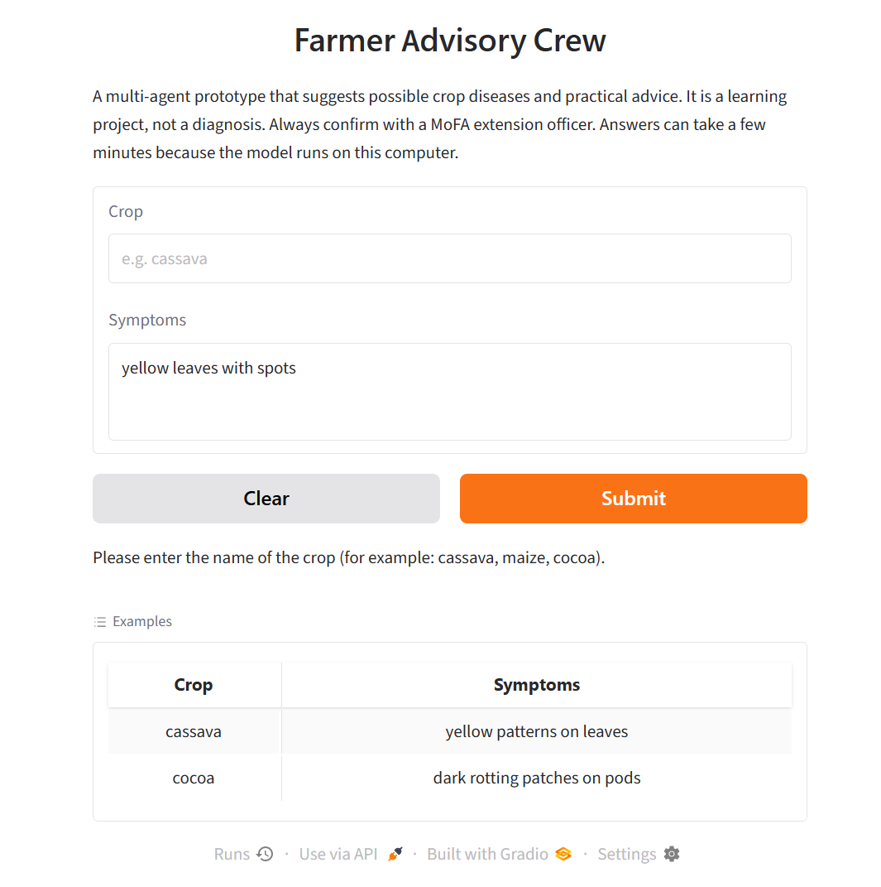
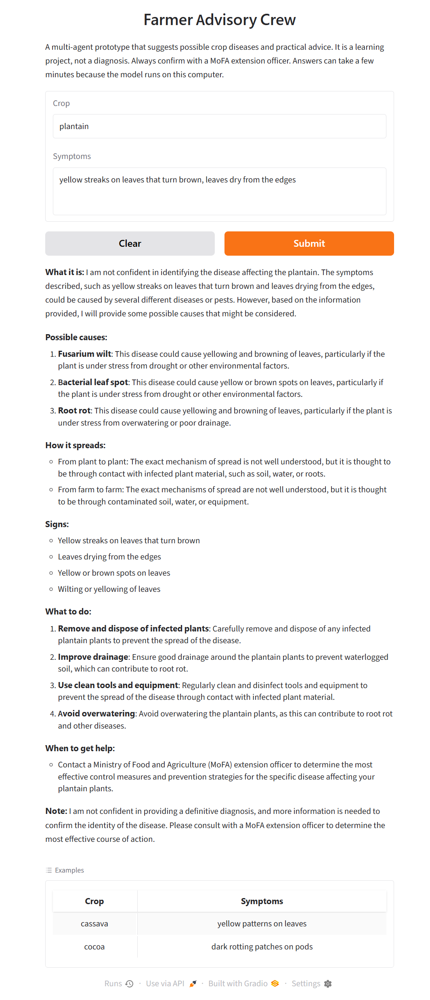

# Farmer Advisory Crew

A multi-agent AI prototype that suggests possible crop diseases from a
crop name, a symptom description and (optionally) a leaf photo, then gives
simple, practical advice for smallholder farmers in Ghana. It can answer in
English or Twi.

> **This is a learning project, not a diagnostic tool.** Always confirm
> with a Ministry of Food and Agriculture (MoFA) extension officer.


## Contents

- [Why I built this]
- [How it works]
- [v2: now it can look at the leaf (and write Twi)]
- [How to run it]
- [Where this started]
- [v1 evaluation]
- [The struggles, and what I learned]
- [Limitations]
- [What I plan to do next]
- [Screenshots]
- [Example outputs]
- [About me]

## Why I built this

I'm a third-year Computer Science student at KNUST
and I'm just starting in AI. I wanted a first project that tackles a real
Ghanaian problem. Many farmers lose crops to diseases they can't identify
early, and extension officers can't be everywhere. This project is my
first step toward understanding how AI could help.

## How it works

Four AI agents work in sequence using [CrewAI](https://www.crewai.com/),
running a local model (llama3.2) through Ollama:

1. **Crop Disease Identifier**: suggests likely diseases from the crop and symptoms
2. **Cause and Spread Analyst**: explains what causes each disease and how it spreads
3. **Treatment and Prevention Specialist**: suggests practical control and prevention steps
4. **Farmer Advice Reviewer**: rewrites everything in plain language and a fixed format

The interface is built with Gradio and includes basic input validation.

## v2: now it can look at the leaf (and  write Twi)

v1 was text only: you typed the crop and symptoms and four AI agents
worked it out. It worked, but it hallucinated disease names and believed
anything I typed. So I upgraded it. The original is still in
`versions/projectcrew_v1_text_only.py` if you want to compare.

| | v1 | v2 |
|---|---|---|
| Input | crop and text symptoms | adds an optional leaf photo and a language choice |
| Agents | 4 | 4 (the photo result is passed to the Identifier as a hint) |
| Extras | none | image classifier, confidence check, crop mismatch warning, Twi translation |
| Known issues | hallucinated names, accepts impossible inputs | photo model unproven on real field photos, Twi not yet checked by a native speaker |

### What's new

- **Leaf photo upload (optional).** A small image classifier looks at the
  photo and gives the Identifier agent a hint. It is only a hint, never
  treated as the answer.
- **Confidence check.** If the classifier is not sure (under 70%), the app
  says so at the top of the answer instead of pretending.
- **Crop mismatch warning.** If I type "maize" but upload a tomato leaf,
  the app tells me(though sometimes it is the wrong answer).
- **Twi option.** The final advice can be translated into Twi using
  GhanaNLP's [Khaya](https://translation.ghananlp.org) translation API.
  The English version is shown right under it.
- **Honest fallbacks.** If the photo model can't load, or the crop is not
  covered (cassava, for example), the app says the photo was not used
  instead of crashing.

### How the photo part works

I took a ResNet18 that was already trained on ImageNet and trained it on
the PlantVillage dataset (38 classes, 14 crops) on a free Kaggle GPU. First
I trained only the last layer, then I unfroze the last block and
fine-tuned it. The training notebook is in
`notebooks/plantvillage_resnet18_training.ipynb`.

| Stage | Validation accuracy |
|---|---|
| Last layer only (1 epoch) | 90.6% |
| Fine-tuned last block (2 more epochs) | 97.6% (10,861 validation images) |

The weakest classes were the lookalikes: corn Northern Leaf Blight
(recall 0.77, often called Gray leaf spot), tomato Early blight (recall
0.84, often called Target Spot), and Grape Esca (often called Black rot).
Diseases that look alike are hard for people too.

### Where it broke

- A healthy tomato photo from Wikimedia Commons [add author and licence]
  was classified as Tomato Yellow Leaf Curl Virus at 67% confidence. That
  is wrong, but it fell under my 70% threshold, so the app flagged it as
  unsure. This is exactly why the confidence check exists.
- 97.6% looks great, but PlantVillage photos are single leaves on plain
  backgrounds. Real farm photos are messier, so I do not trust that number
  in the field yet. I tested only 2 outside photos, which is too few to
  report a real field accuracy.
- The classifier only knows its 38 classes and will always pick one. It
  has no "none of the above" option.
- **No cassava, cocoa, yam or plantain**, which matter a lot in Ghana. The
  text crew still works for them, but the photo check does not.
- Windows Smart App Control blocked part of `torchvision`, so for the app
  I rewrote the ResNet18 in plain PyTorch. It loads the same trained
  weights.

### Twi: read this before trusting it

The translation is automatic, and I have not yet had a fluent Twi speaker
check it. Treat it as a first draft, not advice. The app prints this
warning under every Twi answer.

## How to run it

1. Install [Ollama](https://ollama.com) and download the model: `ollama pull llama3.2`
2. Create and activate a virtual environment:
   ```
   python -m venv cropenv
   cropenv\Scripts\activate
   ```
3. Install the requirements (installing `torch` can take a few minutes):
   `python -m pip install -r requirements.txt`
4. Run: `python projectcrew.py`
5. Open the local address shown in the terminal (usually `http://127.0.0.1:7860`)

**Photo check:** the trained model file (`models/plant_resnet18_ft.pth`) is
not in this repo because of its size. To make your own, run the training
notebook in `notebooks/` [add a link to the Kaggle notebook if you publish
it]. Without the model file, the app falls back to text only.

**Twi:** set an environment variable named `KHAYA_API_KEY` in your terminal
(PowerShell: `$env:KHAYA_API_KEY="your-key"`). You can get a key at
[translation.ghananlp.org](https://translation.ghananlp.org). Never put the
key in the code. The key is needed only for the Twi option.

Answers can take a few minutes because the model runs on my own laptop.
Tested with Python 3.12 on Windows 11.

## Where this started

I began with the multi-agent CrewAI course from DeepLearning.AI by Joe Moura. I then
adapted the idea to agriculture: I designed the four agents and their
roles, wrote the tasks and output format, added safety rules (no
invented chemicals or dosages), built the interface and validation, and
tested it myself.

## v1 evaluation

I tested the text-only version (v1) on 7 cases and checked the results
against the sources noted in the table (FAO, CABI and Kloppert Global).

| Input | Disease named | Correct? | Problems | Sources checked |
|---|---|---|---|---|
| Cassava, yellow patterns on leaves | Cassava mosaic virus | Partly | Wrong acronym, invented a disease, wrong spread routes | FAO |
| Maize, brown spots with yellow edges | Gray leaf spot | Plausible | Overconfident, padded list, impractical advice | FAO / CABI |
| Cocoa, dark rotting patches on pods | Phytophthora pod rot | Yes | Padded list, repeated text | not recorded |
| Tomato, leaves curling with white powder | Unclear | No | Over-cautious, invented causes | Kloppert Global |
| Plantain, yellow streaks turning brown | Fusarium wilt | Doubtful | Overconfident, missed Sigatoka | not recorded |
| Cassava, "rotting pods" | Fusarium wilt | No | Did not notice cassava has no pods | not recorded |
| "Plant looks sick" | Declined | Yes | Correctly asked for more detail | not needed |

## The struggles, and what I learned

**Setup problems.** Getting a working environment took real effort.
I hit `ModuleNotFoundError` for CrewAI, a "charmap" encoding error when
saving output from PowerShell, and a Windows Smart App Control block
that stopped Gradio from running. I learned to read error messages
carefully, use virtual environments, and fix problems step by step
instead of guessing.

**The Reviewer dropped the disease name.** My first runs produced final
answers that left out the disease identified by earlier agents. By
reading each agent's output I found the problem was partly my own
prompt, which told the Reviewer to remove "anything unsure". I rewrote
its goal and added a required slot for the disease name and spread
routes. This taught me that multi-agent systems fail in the hand-offs
between agents, not only in the agents themselves.

**Hallucinations.** The small model confidently invented facts: a made-up
disease, a viral disease described as a fungus, and treatments with no
support. Because each agent trusted the one before it, errors carried
through to the final answer. This showed me why AI systems need
verified knowledge sources and honest evaluation.

**Overconfidence.** The system gave "High confidence" on vague symptoms
and missed that cassava has no pods. I learned that a confident answer
isn't the same as a correct one.

**A high score is not the same as a useful model.** The image classifier
reached 97.6% on its own dataset, yet a real photo of healthy tomato
leaves confused it. I learned to look at where a model fails, and to
report it, instead of quoting only the headline number.

**Losing work.** I lost a trained model once because Kaggle clears its
working files when a session ends. Now I download and back up important
files right away.

## Limitations

- A small local model (llama3.2, 3B) with unreliable specialist knowledge
- No verified reference source, so errors can go unnoticed
- Errors pass from one agent to the next,also had difficulty identifying crops when there was a mismatch with the picure and the name.
- Inconsistent confidence, and no check that symptoms match the crop
  (the photo check adds a mismatch warning, but only for covered crops)
- The photo classifier was trained on lab-style images and has not been
  properly tested on real field photos
- The classifier covers only 38 classes in 14 crops. It does not cover
  cassava, cocoa, yam or plantain, and it has no "none of the above"
- Twi is machine-translated and not yet verified by a native speaker
- No ability to ask follow-up questions
- Small, manual evaluation, which is not enough to measure accuracy
- Limited Ghana-specific local data

## What I plan to do next

- Test the photo classifier on real field photos (including my own) and
  report the gap
- Add a verified reference file (FAO/CABI/MoFA guidance) and restrict
  agents to it
- Make the system check that symptoms fit the crop and cap confidence on
  vague input
- Have a native Twi speaker check the translations and report the error
  rate
- Test a larger model (for example llama3.1:8b) and compare results
- Add a Ghanaian crop such as cassava, with its own dataset
- Expand evaluation to more crops and cases

## Screenshots


**v1 screenshots**





## Example outputs

Full outputs from every agent are saved in the `examples` folder, so you
can see how each stage behaved:

- [Cassava: yellow patterns on leaves](examples/cassava_test1.txt)
- [Maize: brown spots with yellow edges](examples/maize_test1.txt)
- [Cocoa: dark rotting patches on pods](examples/cocoa_test1.txt)
- [Tomato: leaves curling with white powder](examples/tomato_test1.txt)
- [Vague input: "plant looks sick"](examples/vague_test1.txt)
- 

## Credits

- [PlantVillage dataset](https://www.kaggle.com/datasets/mohitsingh1804/plantvillage)
  (Kaggle upload by mohitsingh1804, derived from the original PlantVillage
  data). Check the dataset page for the licence.
- [Khaya](https://translation.ghananlp.org) translation API by GhanaNLP
- The CrewAI course by DeepLearning.AI[https://crewai.com]
- [Add the Wikimedia Commons photo credit here]

## About me

I am Adiel Tweneboah-Koduah, a third-year student at KNUST interested in AI and
machine learning. I'm learning in public, and I welcome feedback and
suggestions. https://www.linkedin.com/in/adiel-tweneboah-koduah-406a68355
